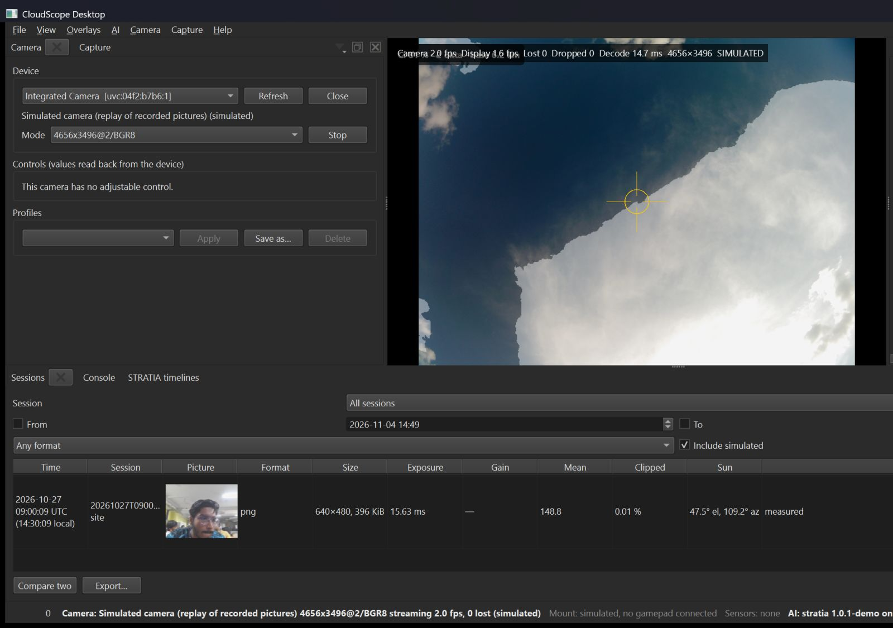

# Mask refinement and glare rule — follow-up to P068 (2026-11-05)

**Why.** After the AI-day demo the owner reported that the cloud masks CloudScope draws did not look right. Rendering
the `stratia-1.0.1-demo` graph's sky parse on eleven B0268 frames (adaptation days and the rehearsal of 2026-10-25,
never STRATIA's locked day) showed three things: the 128 × 128 output stretched over the 16 MP frame is blocky;
the learned glare class never fires on this camera, so the saturated sky around the Sun is drawn as cloud
(STRATIA P093 had measured both); and the hazy sky between clouds is often called cloud. The first two are fixed
in the application; the third needs mask labels or self-training on this camera and is left to STRATIA.

**What changed** (`core/include/cloudscope/ai/mask_refine.hpp`, `core/src/ai/mask_refine.cpp`, wired into
`decode_outputs`):

1. *Image-guided upsampling.* Each class probability of the sky parse and of the layers is upsampled to the model's
   512 × 512 input and refined with a guided filter (He, Sun and Tang 2010; radius 16, two passes, ε 10⁻³) whose
   guide is the grey picture at that size, then the classes are the argmax. On a synthetic step, an edge that the
   grid puts 6–10 px away from the picture's edge lands on the picture's edge (unit test). The drawn mask is now
   512 × 512 instead of 128 × 128 and follows the cloud outlines.
2. *Glare rule.* With the frame's geometry known, the Sun is located in the picture as the brightest 31-px plateau
   among the pixels whose zenith angle (from the ray map's z, which does not depend on the camera's rotation about
   the zenith) is within 20° of the Sun's; when that plateau is saturated (≥ 0.90 of full scale), cloud pixels
   within 25° of it (dot product of ray directions, frame-free) that are saturated become `sun_glare`. The
   `Prediction` records `masks_refined`, `sun_pixel` and `glare_rule_pixels`; the logged fractions are those of
   the refined mask.

**A finding on the way.** The Sun computed from the B0268 ray map sat in the wrong corner of every frame: the
camera's pointing is a declared zenith with no measured rotation about it, so the Sun-aligned frame of its ray maps
has an arbitrary yaw. The zenith angle per pixel is right, the azimuth to the Sun is not; that is why the glare
rule finds the Sun in the picture and never trusts the ray map's azimuth. A Sun-track yaw calibration of the
B0268 (owner item, with the intrinsic calibration of P031) would fix the ray maps for the next STRATIA adaptation.

**Evidence.** Unit tests `tests/unit/test_mask_refine.cpp` (guided filter: flat regions unchanged, edge snaps to
the picture; ray field; Sun found on its ring and the far cumulus untouched). Debug replay run of the 2026-10-19
frames through the desktop with the model on DirectML (58 ms per frame, 0 failed):

The prototype of the same steps in Python on the eleven frames (STRATIA scratch work, same parameters) put
between 1 % and 8 % of the pixels of the sunny frames into glare instead of cloud and left the overcast frames as
they were. STRATIA's reported numbers are unchanged: both steps are presentation-side post-processing in the host,
not part of the exported graph (`STRATIA/docs/release/release_notes_1.0.1-demo.md` says so).
